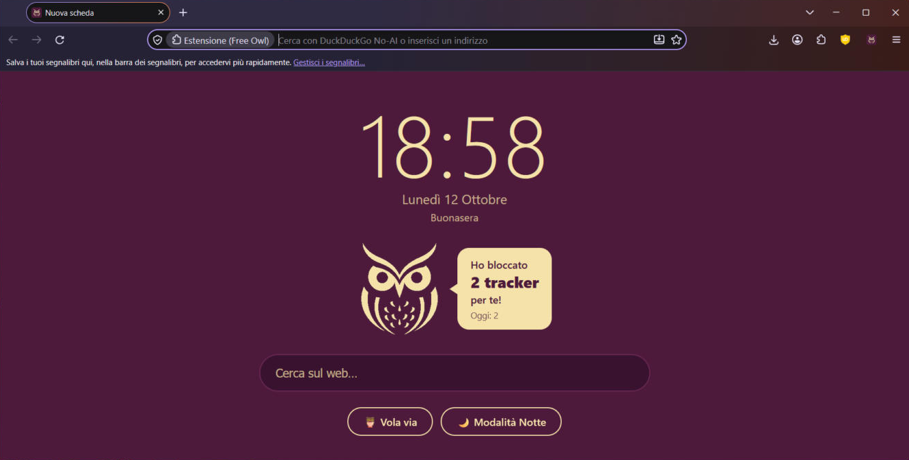

<p align="center">
  
</p>

<h1 align="center">Free Owl 🦉</h1>

<p align="center">
  Un browser per Windows che rispetta la tua privacy, basato su <a href="https://librewolf.net">LibreWolf</a> e Firefox.
</p>

<p align="center">
  
</p>

## Cosa ha di speciale

- 🕐 **Nuova scheda tutta sua**: orologio grande, data, saluto e ricerca veloce.
- 🦉 **Il gufo che ti protegge**: ti dice quanti tracker ha bloccato per te, in totale e oggi.
- 🪶 **Vola via**: un clic (più uno di conferma) e cancella cookie, cronologia, cache e schede aperte. Password e account restano.
- 🌙 **Modalità Notte**: rende scuri tutti i siti chiari, lasciando foto e video con i colori giusti.
- 🔍 **Niente motori che ti tracciano**: Google, Bing, Yahoo, Ecosia e simili sono rimossi. Di default c'è DuckDuckGo, e puoi scegliere tra Brave Search, Startpage, Mojeek e Qwant.
- 🍪 **Meno cookie**: i cookie di terze parti sono bloccati e i banner dei cookie vengono rifiutati da soli.
- 🔒 **HTTPS forzato** su tutti i siti.
- 🛡️ **uBlock Origin** già installato, con le liste italiane e quelle anti-banner dei cookie.
- 🔄 **Account Mozilla attivo**, per sincronizzare segnalibri e password (cifrati end-to-end).

E sotto, tutta la protezione di LibreWolf: niente telemetria, protezione dal fingerprinting, nessuna pubblicità nella nuova scheda.

## Come si installa

1. Vai nei [**Download (Releases)**](../../releases/latest) e scarica `FreeOwl-...-windows-x86_64-portable.zip`.
2. Estrai lo zip dove vuoi (per esempio in `Documenti`).
3. Apri `FreeOwl.exe`.

> **"Windows ha protetto il PC"?** È normale: Free Owl non ha una firma digitale a pagamento.
> Clicca **Ulteriori informazioni** e poi **Esegui comunque**.

Free Owl è *portable*: non serve installarlo e i tuoi dati restano nella cartella `Profiles`.

## Aggiornamenti

Ogni giorno GitHub controlla in automatico se è uscita una nuova versione di LibreWolf. Se sì, costruisce e pubblica il nuovo Free Owl nei [Download](../../releases).

Per aggiornare: chiudi Free Owl, scarica il nuovo zip e copia la cartella `Profiles` della vecchia versione dentro quella nuova, così tieni segnalibri e impostazioni.

## Da sapere

- **Solo Windows (64 bit)**, per ora.
- **Estensioni non firmate permesse**: servono per l'estensione del gufo, che è inclusa in Free Owl. Installa estensioni solo da [addons.mozilla.org](https://addons.mozilla.org).
- **Il contatore dei tracker è una stima**: conta le richieste di terze parti bloccate prima di partire (da uBlock Origin o dalla protezione antitracciamento).
- **Cookie di terze parti bloccati**: raramente qualche login tipo "Accedi con Google/Apple" su altri siti può non funzionare. Si risolve aggiungendo un'eccezione per quel sito (lucchetto nella barra degli indirizzi).

## Come funziona (per i curiosi)

Free Owl **non ricompila** Firefox. Lo script [`build.ps1`](build.ps1):

1. scarica LibreWolf portable ufficiale e ne verifica l'impronta SHA256;
2. cambia nome e logo in tutte le lingue e nelle icone dei `.exe`;
3. aggiunge le impostazioni di [`config/freeowl.cfg`](config/freeowl.cfg) e le policy di [`config/policies.json`](config/policies.json);
4. include l'estensione Free Owl ([`extension/`](extension));
5. crea lo zip pronto da scaricare.

Per costruirlo da solo, su Windows:

```powershell
powershell -ExecutionPolicy Bypass -File build.ps1
```

## Licenza e ringraziamenti

Free Owl è distribuito sotto la [Mozilla Public License 2.0](LICENSE).

È basato su [**LibreWolf**](https://librewolf.net) e su [**Mozilla Firefox**](https://www.mozilla.org/firefox/). Free Owl è un progetto indipendente: non è affiliato né approvato da LibreWolf o Mozilla. Firefox è un marchio di Mozilla Foundation.

Include [uBlock Origin](https://github.com/gorhill/uBlock) di Raymond Hill (GPLv3), installato dal sito ufficiale di Mozilla al primo avvio. Per cambiare l'icona dei `.exe` usa [rcedit](https://github.com/electron/rcedit) (MIT).
