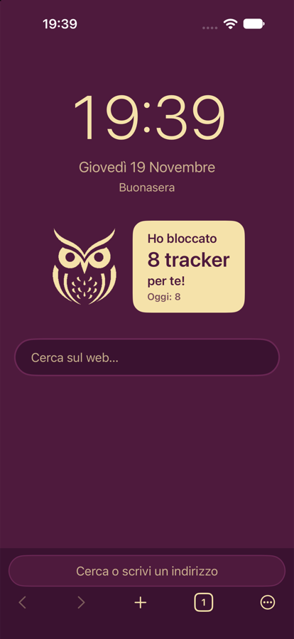

# Free Owl per iPhone 🦉📱

  

La versione per iPhone e iPad di Free Owl, scritta in SwiftUI.

Su iPhone Apple obbliga tutti i browser a usare **WebKit** (il motore di Safari), quindi qui non c'è LibreWolf: le funzioni di Free Owl sono rifatte sopra WebKit.

> ⚠️ **In prova.** Funziona nel simulatore, ma non è ancora nell'App Store.

## Cosa fa

- 🕐 **Nuova scheda** con orologio, data, saluto e ricerca veloce.
- 🦉 **Il gufo** ti dice quanti tracker ha bloccato, in totale e oggi. Lo scudo nella barra mostra quelli della pagina aperta.
- 🛡️ **Blocco di tracker e pubblicità** (Google Analytics, Facebook, reti pubblicitarie e statistiche, anche italiane) con il blocco contenuti di WebKit.
- 🍪 **Banner dei cookie nascosti**, compresi iubenda, OneTrust, Cookiebot e Didomi.
- 🪶 **Vola via**: cancella cookie, cronologia e cache e chiude tutte le schede.
- 🌙 **Modalità Notte**: scurisce i siti chiari e lascia stare foto, video e siti già scuri.
- 🔍 **Solo motori di ricerca privati**: DuckDuckGo (predefinito), Brave Search, Startpage, Mojeek, Qwant.
- 🔒 **HTTPS forzato** e cookie di terze parti bloccati da WebKit.

Rispetto alla versione desktop mancano uBlock Origin (non può girare su iPhone) e la sincronizzazione con l'account Mozilla.

## Come provarla

Serve un Mac con **Xcode** (gratis dall'App Store).

1. Apri `ios/FreeOwl.xcodeproj` con Xcode.
2. In alto scegli un iPhone del simulatore e premi ▶︎.

### Sul tuo iPhone

1. Collega l'iPhone al Mac con il cavo.
2. In Xcode, nella scheda **Signing & Capabilities**, scegli il tuo ID Apple come *Team*.
3. Scegli il tuo iPhone in alto e premi ▶︎.
4. Sull'iPhone attiva la **Modalità sviluppatore** (Impostazioni → Privacy e sicurezza) e dai fiducia al tuo account (Impostazioni → Generali → VPN e gestione dispositivi).

Con un ID Apple gratuito l'app va reinstallata ogni 7 giorni.

## Com'è fatta

| File | Cosa fa |
|---|---|
| `FreeOwlApp.swift` | Avvio dell'app e colori di Free Owl |
| `BrowserModel.swift` | Schede, impostazioni, Vola via, Modalità Notte |
| `BrowserTab.swift` | Una scheda: navigazione e HTTPS forzato |
| `BrowserView.swift` | Barra in basso, menu, elenco schede |
| `NewTabView.swift` | La Nuova scheda con il gufo |
| `Blocker.swift` | Elenco dei tracker, banner dei cookie e script della Modalità Notte |
| `SearchEngine.swift` | I motori di ricerca privati |
| `TrackerStats.swift` | Il contatore dei tracker bloccati |
